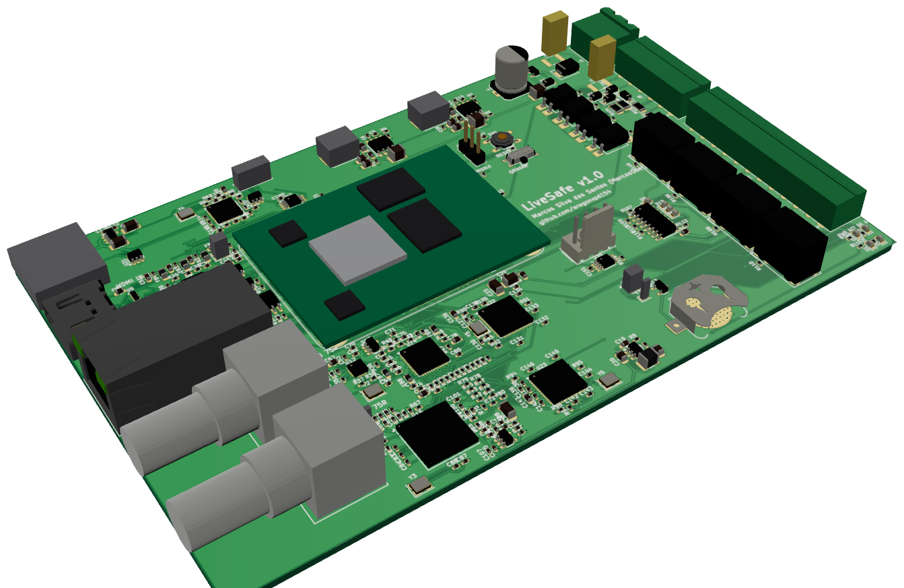
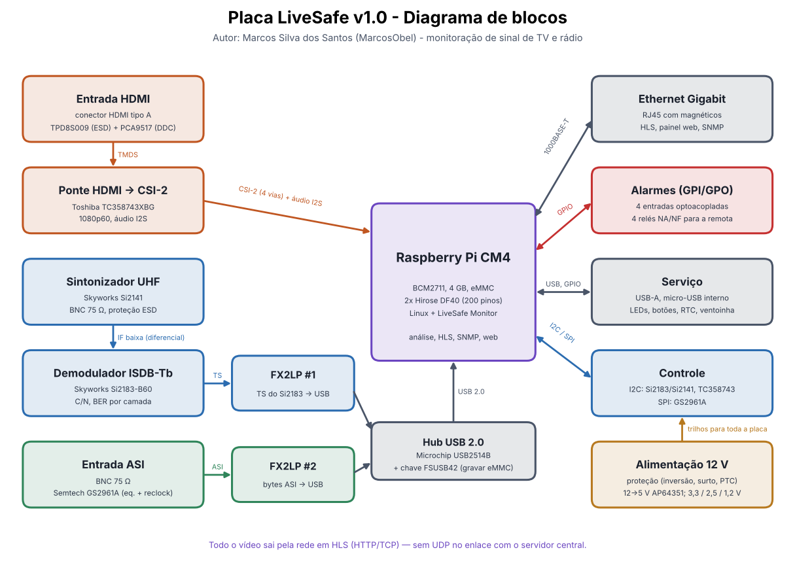
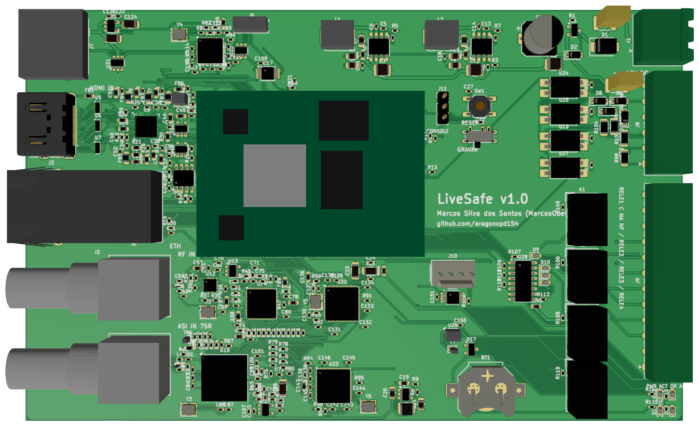
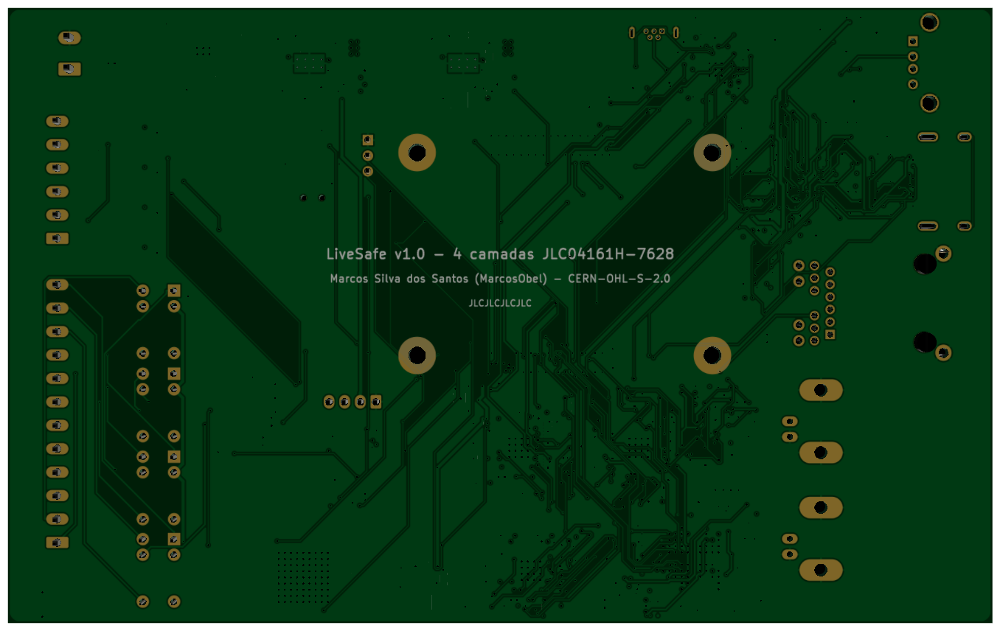

<h1 align="center">Placa LiveSafe</h1>

<h4 align="center">

Placa de monitoração de sinal de TV e rádio para os abrigos de transmissão: recebe **RF ISDB-Tb**, **HDMI** e
**ASI**, roda o [LiveSafe Monitor](https://github.com/aragonxpd154/LiveSafe-Monitor) num Raspberry Pi CM4 e
entrega vídeo ao vivo, alarmes SNMP e contatos de relé. Hardware aberto, gerado por código, pronto para a JLCPCB.

</h4>

<p align="center">


</p>

<p align="center">
<a href="https://aragonxpd154.github.io/LiveSafe-Placa/docs/3d/visualizador.html"></a>
</p>

<p align="center">
<a href="#-o-que-é">O que é</a> ·
<a href="#-status">Status</a> ·
<a href="#-a-placa-em-3d">Placa em 3D</a> ·
<a href="#-fabricar">Fabricar</a> ·
<a href="#-conteúdo-do-repositório">Conteúdo</a> ·
<a href="#-gerar-tudo-de-novo">Gerar de novo</a> ·
<a href="#-licença">Licença</a>
</p>

<p align="center">

</p>

## 📡 O que é

Uma placa só, instalada em cada abrigo, no lugar do conjunto Raspberry Pi + placa de captura USB + receptor:

| Entrada | Caminho | O que o LiveSafe ganha |
|---|---|---|
| **RF ISDB-Tb (UHF)** | BNC 75 Ω → Si2141 → Si2183-B60 → FX2LP → USB | o sinal do ar, sem IRD; C/N e BER do canal |
| **HDMI** | HDMI → TC358743XBG → CSI-2 (4 vias) + I2S | a saída do IRD/receptor sem placa de captura |
| **ASI** | BNC 75 Ω → GS2961A → FX2LP → USB | o transport stream do encoder ou do multiplexador |

Saídas: Ethernet Gigabit (painel web, HLS, SNMP), 4 relés SPDT e 4 entradas optoacopladas para a remota do
abrigo, RTC com bateria, controle de ventoinha. Alimentação única de **12 V** (9 a 18 V).

<p align="center">

</p>

## 🚧 Status

| Etapa | Situação |
|---|---|
| Escolha dos chips e arquitetura | ✅ [docs/01](docs/01-arquitetura.md) |
| Pinagens conferidas nos datasheets (Si2183, Si2141, GS2961A) | ✅ `tools/pinagens.py` |
| Esquemático (9 folhas, netlist conferida pelo KiCad) | ✅ [PDF](hardware/esquema-eletrico-completo.pdf) · [docs/02](docs/02-esquematico.md) |
| PCB 4 camadas 160 × 100 mm — **DRC limpo (0 erros, 0 ligações pendentes)** | ✅ [docs/03](docs/03-pcb.md) |
| Arquivos JLCPCB (Gerber, BOM com código LCSC, CPL, STEP) | ✅ [docs/04](docs/04-fabricacao-jlcpcb.md) |
| Protótipo de bancada com módulos prontos | ⏳ [docs/07](docs/07-prototipo-de-bancada.md) |
| Primeira placa fabricada e testada | ⏳ [docs/05](docs/05-montagem-e-testes.md) |

> **Revisão antes de fabricar.** É a revisão 1.0, nunca fabricada. Os pontos em aberto estão em
> [docs/08](docs/08-revisao-e-riscos.md): rede de entrada de RF do Si2141 (datasheet completo sob NDA), pares
> diferenciais roteados automaticamente e as rotações da montagem JLCPCB. Recomenda-se a revisão de um
> projetista de hardware e um lote pequeno (5 placas) antes da produção.

## 🧊 A placa em 3D

<p align="center">


</p>

O visualizador ([docs/3d/visualizador.html](docs/3d/visualizador.html)) abre o modelo com as camadas reais de
cobre, máscara e serigrafia. O modelo mecânico está em `hardware/fabricacao/livesafe-placa/livesafe-placa.step`.

## 🏭 Fabricar

1. Gerber: `hardware/fabricacao/livesafe-placa/livesafe-placa-gerber.zip` — 4 camadas, 1,6 mm, impedância
   controlada **JLC04161H-7628**, ENIG.
2. Montagem: `bom-jlcpcb.csv` + `cpl-jlcpcb.csv` (face de cima), com código LCSC em todas as linhas. Conferir
   as rotações na pré-visualização.
3. `pecas-fora-da-jlcpcb.csv`: conectores de furo (solda manual), TC358743 e indutor de 6,8 µH (*Global
   Sourcing*), CM4 (CM4104032) e bateria CR1220, que entram depois, à mão.

Passo a passo completo em [docs/04](docs/04-fabricacao-jlcpcb.md); primeiros testes em [docs/05](docs/05-montagem-e-testes.md).

## 📁 Conteúdo do repositório

| Pasta | O que tem |
|---|---|
| `hardware/kicad/livesafe-placa/` | projeto KiCad 7 (esquemático hierárquico e PCB) |
| `hardware/kicad/bibliotecas/` | símbolos e footprints próprios (CM4, TC358743 BGA-64 0,65 mm, Si2141 com pads de canto) |
| `hardware/fabricacao/livesafe-placa/` | Gerber, BOM, CPL, STEP, PDFs de conferência, relatório de DRC |
| `hardware/esquema-eletrico-completo.pdf` | o esquema completo |
| `docs/` | arquitetura, esquemático, PCB, fabricação, testes, software, protótipo de bancada, riscos |
| `tools/gerador-kicad/` | o gerador: `designs.py` (todas as ligações), `layouts.py` (planta), `pcbgen.py`, `completar.py` (roteador de acabamento), `lcsc.py` (códigos LCSC), `fabricacao.py` |
| `ref/` | pinagens conferidas (JSON) e referências de terceiros |

## 🔁 Gerar tudo de novo

```bash
sudo apt install kicad openjdk-21-jre xvfb python3-pip  # KiCad 7 ou mais novo
pip install trimesh cascadio playwright pillow numpy pypdf
cd tools/gerador-kicad
wget https://github.com/freerouting/freerouting/releases/download/v1.9.0/freerouting-1.9.0.jar
# (o 1.9 respeita o limite de passadas -mp; roda numa tela virtual com xvfb-run)
/usr/bin/python3 gerar_tudo.py              # esquemático, PCB roteada (Freerouting + completar.py), DRC e JLCPCB
python3 ../diagramas.py                     # diagrama de blocos
python3 ../render3d.py && python3 ../render_imagens3d.py   # modelo 3D e imagens
```

> O Freerouting não é determinístico: cada rodada sai diferente e pode precisar de acabamento (docs/03). A placa
> versionada é a referência. Para só atualizar valores/códigos sem mexer no cobre: `sincronizar.py`.
>
> Regerar **substitui** os arquivos do KiCad. Se você editar a placa à mão no KiCad (por exemplo, ajustar os
> pares diferenciais com o roteador interativo), passe a manter a placa manualmente ou leve a mudança para o
> `designs.py` / `layouts.py`.

## 👤 Autor

**Marcos Silva dos Santos** (MarcosObel) — [github.com/aragonxpd154](https://github.com/aragonxpd154)

## 📄 Licença

Hardware sob **CERN-OHL-S-2.0**. Partes de terceiros mantêm a licença original: circuito de referência do
TC358743 e footprint do DF40 (Antmicro, Apache-2.0), footprint do CM4 (Raspberry Pi Ltd., projeto KiCad da placa CM4IO, CC BY 4.0),
SDK do Si2183/Si2141 (Skyworks, Apache-2.0).
