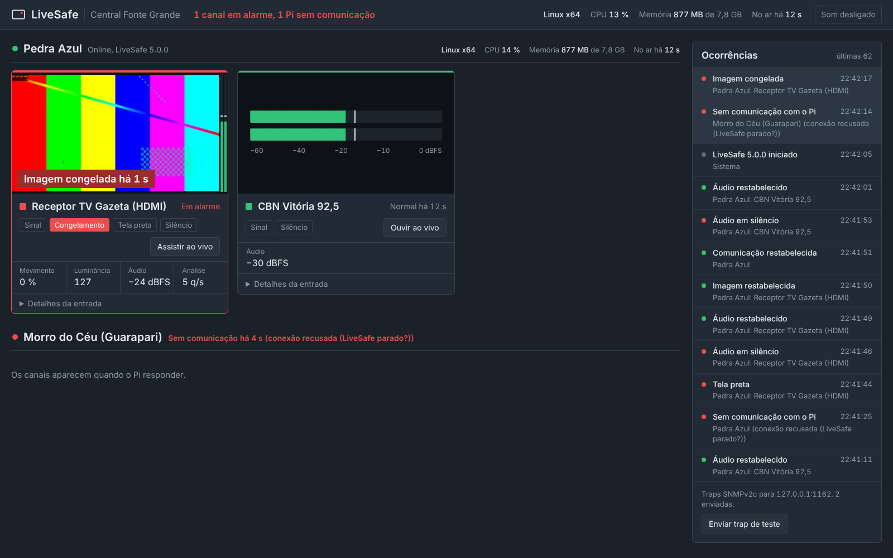
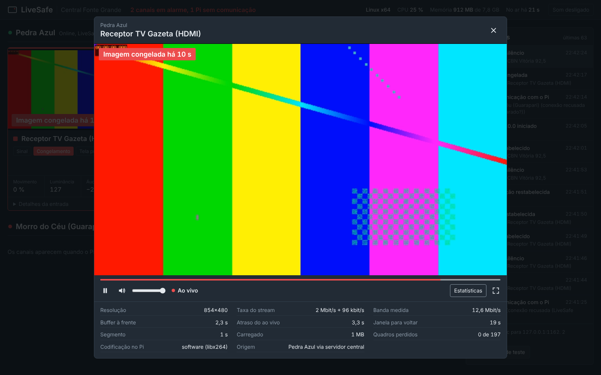
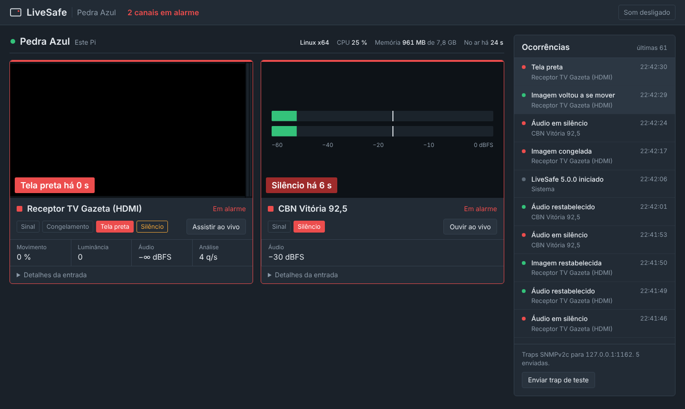
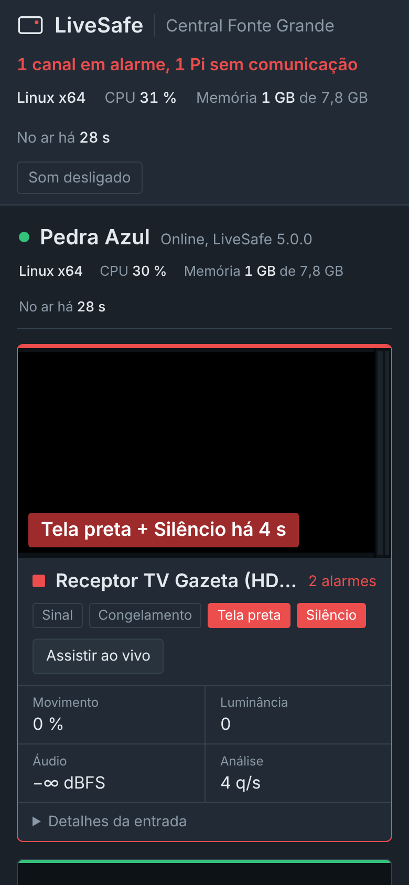
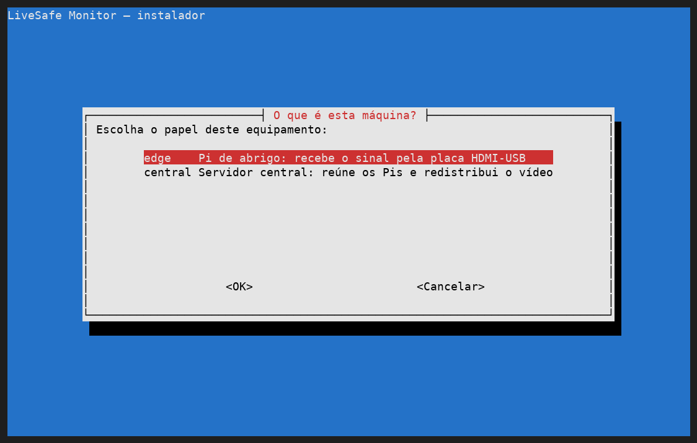
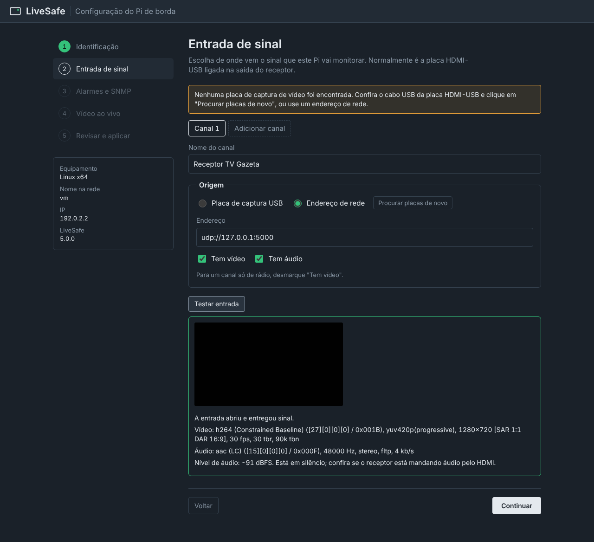
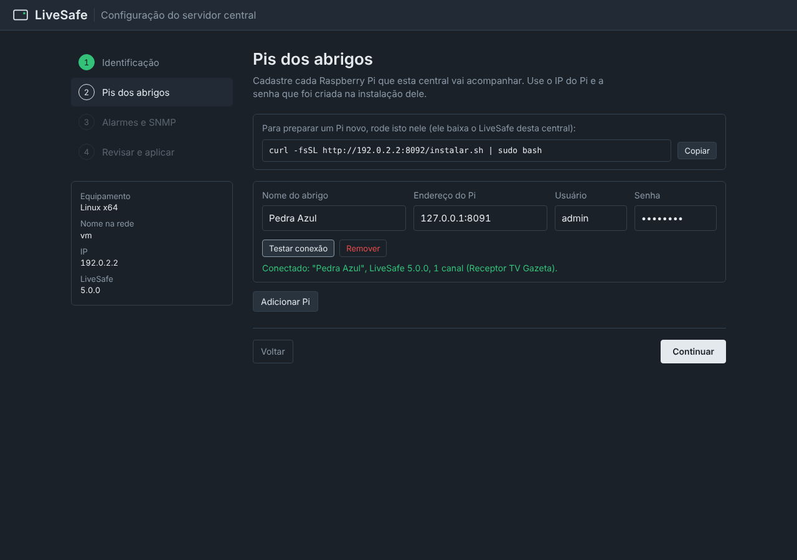

# LiveSafe Monitor

Monitoração de sinal de TV e rádio para rodar em Raspberry Pi. Cada Pi fica num abrigo, recebe o sinal do receptor por uma placa de captura HDMI-USB, detecta falhas sozinho e manda trap SNMP. Um servidor LiveSafe central reúne todos os Pis numa tela só e redistribui o vídeo ao vivo de cada local pelo navegador, com um player parecido com o do YouTube.



## O que ele detecta

| Falha | Como | Trap (alarme / normalizado) |
| --- | --- | --- |
| Imagem congelada | menos de 0,1 % dos pixels mudando por 10 s | 2 / 12 |
| Áudio em silêncio | nível abaixo de −60 dBFS por 10 s | 3 / 13 |
| Tela preta | 98 % da tela escura por 5 s | 4 / 14 |
| Sem sinal na entrada | placa ou stream sem entregar dados por 8 s | 5 / 15 |
| Sem comunicação com o Pi (só no central) | Pi não responde por 10 s | 6 / 16 |

Os tempos e limiares são configuráveis por canal. Tela preta tem prioridade sobre congelamento (uma tela preta também está "parada" e não deve gerar dois alarmes). Durante uma queda de sinal os outros detectores ficam suspensos, então não chegam traps falsas de congelamento ou silêncio.

## Como funciona

```
 Abrigo (um Pi em cada)                         Sala de controle

 Receptor ──HDMI──▶ placa HDMI-USB ──USB──┐
                                          ▼
 ┌─────────────────────────────────────────┐   HTTP/TCP    ┌──────────────────────────────┐
 │ Raspberry Pi 4 — LiveSafe de borda      │──────────────▶│ Servidor LiveSafe central    │
 │  • detecta falhas e manda traps         │ estado (SSE)  │  • estado de todos os Pis    │
 │  • gera o stream HLS na RAM             │ vídeo (HLS)   │  • alarme "sem comunicação"  │──▶ navegadores
 └─────────────────────────────────────────┘               │  • repassa o vídeo com cache │    (painel e player)
                                                           └──────────────────────────────┘
```

- **Um ffmpeg por canal.** Decodifica uma única vez e entrega: quadros 160×90 em cinza para a análise, áudio de 16 kHz para os medidores, um JPEG por segundo para a miniatura e o stream ao vivo em HLS (H.264 + AAC).
- **Sem UDP no enlace.** Tudo entre o Pi e o central é HTTP sobre TCP: o estado vai por uma única conexão Server-Sent Events e o vídeo em segmentos HLS de 1 s. Nada de multicast ou fluxo UDP contínuo saindo do abrigo.
- **O enlace só carrega o que está sendo assistido.** O central busca cada segmento do Pi uma vez e entrega para todos que estão assistindo. Dez pessoas olhando Pedra Azul geram um único download até Pedra Azul.
- **Buffer pequeno.** Segmentos de 1 s e player sincronizado a 3 segmentos do ao vivo: atraso típico de 3 a 4 s. A barra do player permite voltar até 30 s.
- **Feito para o Pi.** Codificação H.264 por hardware (`h264_v4l2m2m`) no Pi 4, com troca automática para software se o hardware não estiver disponível. O HLS fica em `/run/livesafe` (RAM) e o log vai para o journald, então o cartão SD quase não é escrito.
- **Se recupera sozinho**, em camadas (detalhes abaixo).
- **Leve.** Só duas dependências npm (`net-snmp` e o `hls.js` do player), servidor HTTP nativo do Node, painel sem CDN que funciona numa rede sem internet.

## Recuperação automática

Um Pi num abrigo não tem ninguém do lado para apertar botão, então cada tipo de falha tem quem cuide dela:

| O que acontece | Quem resolve | Tempo até voltar |
| --- | --- | --- |
| Pi reinicia (falta de energia, reboot) | systemd sobe o LiveSafe no boot; se a placa HDMI-USB demorar a aparecer, a captura tenta de novo sozinha | o tempo do boot + até 30 s |
| ffmpeg cai | LiveSafe religa com espera crescente (2, 4, 8… até 30 s) | 2 s na primeira vez |
| ffmpeg trava sem cair (comum com placa USB) | vigia interno: 8 s sem quadros ou áudio, mata e religa | ~10 s |
| Entrada normal, mas o stream ao vivo parou | vigia interno: playlist parada por 10 s, reinicia a captura e registra a ocorrência | ~15 s |
| LiveSafe cai | systemd religa em 3 s e derruba junto qualquer ffmpeg órfão | 3 s |
| LiveSafe trava sem cair | `livesafe-watchdog.timer`: a cada 30 s testa o `/healthz`; 3 falhas seguidas, reinicia o serviço | até ~1 min |
| Memória dispara | teto de 1,2 GB no systemd; o serviço é reiniciado | 3 s |
| Pi inteiro congela (kernel, calor) | watchdog de hardware do Raspberry Pi: reinicia a placa | 14 s + boot |
| Enlace com o abrigo cai | central alarma "sem comunicação", reconecta sozinho e traz as ocorrências do período fora; o player tenta de novo a cada 3 s | assim que o enlace volta |

Num Raspberry Pi, o instalador pergunta se deve ligar o watchdog de hardware (recomendado; pode pedir um reboot na primeira vez). O que o vigia fez fica em `journalctl -t livesafe-watchdog`.

## Player ao vivo

Clique em **Assistir ao vivo** em qualquer canal. A barra mostra o que já foi carregado (cinza claro) e onde você está (vermelho); o selo **Ao vivo** fica vermelho quando você está na ponta e, se você voltar no tempo, um clique nele traz de volta. **Estatísticas** mostra resolução, taxa, banda medida, buffer à frente, atraso em relação ao ao vivo e quadros perdidos. Atalhos: espaço pausa, `M` silencia, `F` tela cheia, setas voltam ou avançam 5 s.



Canais só de áudio (rádios FM) ganham medidores grandes no lugar da imagem e o botão **Ouvir ao vivo**.

| Pi de borda | Celular |
| :---: | :---: |
|  |  |

## Instalação

Requisitos: Raspberry Pi 4 (2 GB ou mais) com Raspberry Pi OS Bookworm 64 bits, de preferência a versão Lite. O servidor central pode ser outro Pi ou qualquer Debian/Ubuntu.

A instalação tem duas partes: o **instalador** pergunta pelo terminal (SSH) o papel da máquina, o nome do local e a senha do painel, e instala tudo; depois, o **assistente no navegador** configura a placa de captura (Pi) ou os Pis dos abrigos (central).



### 1. Instalar

Escolha um dos três caminhos. Os três usam o mesmo instalador e servem tanto para o Pi de borda quanto para o central.

**Com internet (GitHub):**

```bash
curl -fsSL https://raw.githubusercontent.com/aragonxpd154/LiveSafe-Monitor/main/install.sh | sudo bash
```

**Pelo servidor central**, para Pis que enxergam o central mas não a internet. O assistente do central mostra este comando já com o IP certo:

```bash
curl -fsSL http://<ip-do-central>:8080/instalar.sh | sudo bash
```

**Sem internet (pendrive).** Baixe `livesafe-offline-arm64.tar.gz` na página de [releases](https://github.com/aragonxpd154/LiveSafe-Monitor/releases/latest). O arquivo tem cerca de 250 MB e já traz o ffmpeg, o Node.js e todas as dependências para o Raspberry Pi OS Bookworm 64 bits. No Pi:

```bash
tar -xzf livesafe-offline-arm64.tar.gz
sudo ./livesafe-monitor/install.sh
```

Se o central for instalado a partir do pacote offline, ele guarda esses pacotes e os entrega aos Pis que instalarem pelo segundo caminho. Assim, um Pi sem internet instala tudo só falando com o central.

**Gerar o pacote offline no seu PC.** Não precisa de Pi nem de sudo: qualquer computador Debian/Ubuntu com internet (Zorin OS, por exemplo) monta o pacote para o Raspberry Pi OS Bookworm 64 bits, sem instalar nada no PC:

```bash
sudo apt install dpkg-dev debian-archive-keyring gnupg curl   # só na primeira vez
./scripts/build-offline-bundle.sh --pi                         # gera dist/livesafe-offline-arm64.tar.gz
```

O script baixa os pacotes dos repositórios oficiais do Debian e do Raspberry Pi, conferindo as assinaturas, e leva poucos minutos. Rodando com `sudo` e sem `--pi` num Pi com internet, ele gera o pacote para o sistema daquele Pi. O GitHub Actions também gera os dois pacotes a cada tag `v*` (workflow `release.yml`).

Rodar o instalador de novo atualiza o LiveSafe e mantém a configuração, os canais e as senhas.

<details>
<summary>Instalação automatizada, sem perguntas</summary>

```bash
curl -fsSL …/install.sh | sudo LIVESAFE_NONINTERACTIVE=1 LIVESAFE_ROLE=edge LIVESAFE_SITE="Pedra Azul" LIVESAFE_PASSWORD='…' bash
```

`LIVESAFE_ROLE` é `edge` ou `central`. Sem `LIVESAFE_PASSWORD`, uma senha é gerada e mostrada no fim. `LIVESAFE_HW_WATCHDOG=0` não liga o watchdog de hardware.
</details>

### 2. Configurar no navegador

Ao terminar, o instalador mostra o endereço `http://<ip>:8080/setup`. Entre com o usuário `admin` e a senha que você criou.

- **No Pi de borda**, o assistente procura a placa HDMI-USB, sugere o formato e a resolução, e o botão **Testar entrada** mostra um quadro do receptor e o nível do áudio antes de salvar. Também dá para usar um endereço de rede (UDP do IRD, RTSP, HTTP) ou montar um canal só de rádio.
- **No central**, você cadastra cada Pi pelo IP e pela senha dele; **Testar conexão** confirma o nome do abrigo e os canais.
- As etapas seguintes definem os destinos das traps, os tempos de alarme e a qualidade do vídeo ao vivo. Ao salvar, o LiveSafe reinicia já com a configuração nova.

| Pi de borda: entrada de sinal | Central: Pis dos abrigos |
| :---: | :---: |
|  |  |

O assistente continua disponível em `/setup` para mudanças futuras. Logs ao vivo: `journalctl -u livesafe -f`.

## Configuração manual

O assistente grava `/var/lib/livesafe/config.json`, que também pode ser editado à mão (depois, `sudo systemctl restart livesafe`). Há dois exemplos: [`config.edge.example.json`](config.edge.example.json) (Pi de borda) e [`config.central.example.json`](config.central.example.json) (servidor central). A senha do painel é guardada como hash (`passwordHash`); `password` em texto também é aceito.

### Canal com placa HDMI-USB

As placas baratas com chip MS2109 entregam MJPEG e aparecem como duas entradas: vídeo em `/dev/video0` e áudio no ALSA.

```json
{
  "id": "hdmi",
  "name": "Receptor TV Gazeta (HDMI)",
  "inputArgs": [
    "-f", "v4l2", "-input_format", "mjpeg", "-video_size", "1280x720", "-framerate", "30", "-i", "/dev/video0",
    "-f", "alsa", "-channels", "2", "-sample_rate", "48000", "-i", "hw:CARD=MS2109,DEV=0"
  ],
  "videoStream": "0:v:0",
  "audioStream": "1:a:0"
}
```

Outras entradas que o ffmpeg abre também servem, com `"url"` no lugar de `inputArgs`: `udp://@239.10.10.1:1234` (IRD), `rtsp://…`, `http://…`. Para escolher um serviço dentro de um transport stream com vários programas, use por exemplo `"videoStream": "0:p:57345:v:0"`. Rádio só com áudio: `"video": false`.

### Servidor central

```json
"sites": [
  { "id": "pedra-azul", "name": "Pedra Azul", "url": "http://10.10.8.21:8080", "user": "livesafe", "password": "…" }
]
```

`user` e `password` são o usuário e a senha do painel daquele Pi.

### Ajustes mais usados

| Chave | Padrão | Para que serve |
| --- | --- | --- |
| `freeze.seconds`, `freeze.motionPct` | 10 s, 0,1 % | Tolerância a cenas paradas (cartelas, vinhetas). Veja o "Movimento" no painel para calibrar. |
| `black.seconds`, `black.pct` | 5 s, 98 % | Tela preta. |
| `silence.seconds`, `silence.dbfs` | 10 s, −60 dBFS | Silêncio. Rádio costuma precisar de mais tempo. |
| `signal.stallSeconds` | 8 s | Tempo sem dados até "sem sinal". |
| `stream.bitrate`, `stream.width`, `stream.fps` | 2000k, 1280, 25 | Qualidade do vídeo ao vivo. Reduza se o enlace do abrigo for estreito. |
| `stream.windowSeconds` | 30 | Quanto dá para voltar na barra do player. |
| `stream.encoder` | `auto` | `auto`, `h264_v4l2m2m` (hardware do Pi 4) ou `libx264`. |
| `stream.softwareMaxWidth` | 854 | Largura máxima quando a codificação cai para software, para não saturar a CPU. |
| `central.offlineSeconds` | 10 | Tempo sem resposta até "sem comunicação com o Pi". |
| `snmp.traps.version` | `"1"` | `"1"` (como nas versões anteriores) ou `"2c"`. |
| `snmp.agent.enabled` | `false` | Liga o agente SNMP para o NMS consultar o estado (GET/WALK). |

## SNMP

Toda trap leva os mesmos varbinds, sob o enterprise `1.3.6.1.4.1.53864` usado desde a primeira versão:

| OID | Tipo | Conteúdo |
| --- | --- | --- |
| `.1.1` | Integer | código da tabela acima (1 = LiveSafe iniciado, 9 = trap de teste) |
| `.1.2` | Integer | número do canal |
| `.1.3` | OctetString | nome do canal |
| `.1.4` | OctetString | mensagem em português |
| `.1.5` | OctetString | id do canal |

Em SNMPv1 a trap vai como enterprise `1.3.6.1.4.1.53864.0`, specific = código; em v2c o `snmpTrapOID` é `1.3.6.1.4.1.53864.0.<código>`. O botão **Enviar trap de teste** no painel serve para conferir a chegada no NMS.

Com o agente ligado, a tabela `1.3.6.1.4.1.53864.2.1.1.<coluna>.<canal>` traz índice, id, nome, estado geral (1 normal, 2 observação, 3 alarme, 4 iniciando), estado de sinal, congelamento, tela preta e silêncio (0 desligado, 1 normal, 2 suspeita, 3 alarme), movimento ×100, nível de áudio em dBFS ×10 e reinícios. `1.3.6.1.4.1.53864.3.2.0` é o total de alarmes ativos.

```bash
snmpwalk -v2c -c public <ip-do-pi>:1161 1.3.6.1.4.1.53864
```

## API

| Método e rota | O que faz |
| --- | --- |
| `GET /api/state` | Estado completo (canais, Pis, saúde, últimas ocorrências) |
| `GET /api/stream` | Estado ao vivo por Server-Sent Events |
| `GET /api/events?limit=100` | Histórico de ocorrências |
| `GET /hls/<canal>/index.m3u8` | Stream ao vivo do canal (abre também no VLC) |
| `GET /api/channels/<canal>/snapshot.jpg` | Última miniatura |
| `GET /api/channels/<canal>/live.mjpg` | MJPEG contínuo, para multiviewers |
| `POST /api/channels/<canal>/restart` | Reinicia a captura |
| `POST /api/test-trap` | Envia trap de teste |
| `GET /healthz` | Saúde do serviço, sem autenticação; responde 503 se o laço interno parou (usado pelo vigia) |
| `/sites/<pi>/…` | No central: as mesmas rotas de um Pi, repassadas com cache |

## Testar sem placa de captura

```bash
./scripts/test-signal.sh udp://127.0.0.1:5000
```

Gera um sinal em loop com trechos de imagem normal, congelada, preta e silêncio. Aponte um canal para `udp://127.0.0.1:5000` e acompanhe os alarmes. Parar o script testa o "sem sinal". Testes automáticos: `npm test`.

## Estrutura

```
install.sh      instalador com telas no terminal (online, pelo central ou offline)
src/
  index.js      inicialização, laço de 1 s, /healthz e encerramento limpo
  channel.js    um canal: processo ffmpeg, análise, religamento, HLS
  detectors.js  análise de quadro, níveis de áudio e histerese
  encoder.js    escolha do encoder H.264 (hardware do Pi ou software)
  remote.js     servidor central: conexão com os Pis e cache do proxy
  setup.js      assistente: testar entrada, testar Pi, salvar e reiniciar
  devices.js    descoberta de placas V4L2 e ALSA
  installer.js  /instalar.sh e o pacote servidos pelo central
  auth.js       senha do painel (hash scrypt, bloqueio após erros)
  snmp.js       traps e agente SNMP
  web.js        servidor HTTP, SSE, HLS e proxy
  events.js     histórico de ocorrências
  system.js     temperatura, CPU e memória do host
public/         painel, player e assistente (sem dependências externas)
deploy/         instalação sem perguntas, serviço systemd e vigia (watchdog)
scripts/        descoberta de placas, sinal de teste e geração dos pacotes
legacy/         versões 1 a 4, só para consulta
```

## Histórico

A versão 5 reescreve o projeto. As versões anteriores dependiam de uma aba do navegador aberta (v1/v2) ou do Windows com DirectShow (v3), e o painel vinha de outro projeto, com bibliotecas carregadas de CDNs que já saíram do ar. O código antigo está em [`legacy/`](legacy/), sem os executáveis do ffmpeg para Windows que ocupavam cerca de 500 MB do repositório.

## Licença

MIT. Veja [LICENSE](LICENSE).
