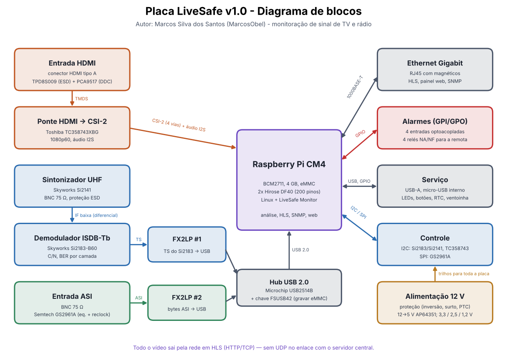

# 01 — Arquitetura da placa LiveSafe v1.0

> Projeto e PCB de **Marcos Silva dos Santos** (MarcosObel). Este documento registra as decisões de
> projeto e o porquê de cada uma. As referências estão no fim.



## O que a placa faz

Uma placa só, instalada em cada abrigo, que recebe o sinal de TV de três formas e entrega tudo
pela rede para o servidor LiveSafe central:

| Entrada | Conector | Caminho até o processador | O que o LiveSafe ganha |
|---|---|---|---|
| **RF ISDB-Tb (UHF)** | BNC 75 Ω (com adaptador F→BNC para o cabo da antena) | Si2141 → Si2183 → FX2LP #1 → USB | o próprio sinal do ar, sem IRD; C/N e BER do canal |
| **HDMI** | HDMI tipo A | TC358743XBG → CSI-2 (4 vias) + I2S | a saída do receptor/IRD, sem placa de captura USB |
| **ASI** | BNC 75 Ω | GS2961A → FX2LP #2 → USB | o transport stream de encoder, IRD ou multiplexador |

Saídas: Ethernet Gigabit (painel web, HLS, SNMP), 4 relés de alarme e 4 entradas optoacopladas
para ligar na remota do abrigo.

Por que BNC também no RF: há footprint conferido (Amphenol B6252HB-NPP3G-75, 75 Ω) e o mesmo conector serve às
duas entradas. O cabo de antena com conector F entra por um adaptador F-macho/BNC-fêmea comum.

## Por que um Raspberry Pi CM4

- **O software já existe:** o LiveSafe roda hoje em Raspberry Pi 4; o CM4 é o mesmo processador (BCM2711).
- **Codificação H.264 por hardware** (h264_v4l2m2m) para o vídeo ao vivo da entrada HDMI, sem gastar CPU.
- **Sem roteamento de memória DDR:** processador, RAM e eMMC vêm prontos no módulo. A nossa placa fica
  em 4 camadas, fabricável e montável na JLCPCB.
- **CSI-2 de 4 vias (CAM1)** no conector: a captura HDMI entra direto no processador, sem USB.

Versão recomendada: **CM4104032** (4 GB de RAM, 32 GB de eMMC, sem Wi-Fi). As versões com Wi-Fi também
servem; as sem eMMC (CM4Lite) não, porque a placa não tem slot de cartão SD.

## Escolha dos chips

| Bloco | Chip | Motivo | Situação no Linux |
|---|---|---|---|
| Ponte HDMI → CSI-2 | **Toshiba TC358743XBG** (BGA-64, 6 × 6 mm, passo 0,65 mm) | 1080p60 em 4 vias, áudio I2S, EDID interno | driver `tc358743` no kernel oficial; overlay `tc358743` da Raspberry Pi |
| Sintonizador | **Skyworks Si2141-A10** (QFN-24, 3 × 3 mm) | digital, sem balun, IF baixa; LCSC C430209 | driver `si2157` no kernel oficial (cobre o Si2141) |
| Demodulador | **Skyworks Si2183-B60** (QFN-48, 7 × 7 mm) | ISDB-T 6 MHz com recepção parcial; TS serial/paralelo; LCSC C2654249 | não está no kernel oficial; usamos o controle em espaço de usuário (ver abaixo) |
| Receptor ASI | **Semtech GS2961A** (BGA-100, 11 × 11 mm) | equalizador de cabo + reclocker + modo DVB-ASI no mesmo chip | sem driver: configurado por SPI pelo nosso software |
| Ponte TS → USB | **Cypress/Infineon CY7C68013A-56 (FX2LP)** ×2 | slave FIFO de 8 bits a até 48 MHz; 40 MB/s em USB 2.0 | firmware aberto nosso + leitura por `libusb` |
| Hub USB | **Microchip USB2514B** | 4 portas USB 2.0 a partir da única USB do CM4 | nativo |
| Chave USB | **onsemi FSUSB42** | leva a USB do CM4 para o conector de serviço na gravação do eMMC | — |

### Por que duas pontes FX2LP e não uma FPGA

Uma FPGA juntaria os dois transport streams numa interface só, mas traria mais um chip BGA, mais trilhos de
alimentação, uma memória de configuração e um projeto de lógica para manter. Cada FX2LP custa poucos
dólares, aceita um TS paralelo de 8 bits direto no modo *slave FIFO* e aparece no Linux como um dispositivo USB
comum. A banda sobra: um canal ISDB-Tb tem cerca de 18 a 23 Mbit/s e um ASI típico de estação fica entre 20 e
60 Mbit/s; uma FX2LP sustenta em torno de 320 Mbit/s.

### Como o LiveSafe controla o demodulador

O Si2183-B60 precisa de um *patch* de firmware carregado a cada inicialização. Ele vem no **SDK oficial da
Skyworks** (`swks-mss/video_si21xx_superset`, licença Apache-2.0); o mesmo arquivo também existe no acervo
`LibreELEC/dvb-firmware` (`dvb-demod-si2183-b60-01.fw`). O clock vem do sintonizador: cristal de 24 MHz no
Si2141, repassado pelo `XOUT` ao pino 44 do Si2183 (modo `CLK_CLKIO` do SDK). O Si2183 e o Si2141 ficam no barramento I2C1 do
CM4, e um serviço em espaço de usuário (`livesafe-rf`) faz a sintonia, lê as estatísticas do canal e entrega o
TS que chega pela FX2LP para o LiveSafe. A sequência de comandos segue o driver GPL da TBS (`si2183.c`) e a
implementação independente do projeto `coax`, que já controla o Si2183 direto por USB.

## Alocação dos pinos do CM4

| Função | Pinos do CM4 | GPIO | Destino |
|---|---|---|---|
| CSI-2 CAM1 dados 0–3 e clock | 115–141 (pares) | — | TC358743 CSID0–3 / CSIC |
| I2C da câmera (CSI1) | 80 SCL0, 82 SDA0 | 45, 44 | TC358743 (0x0F), RTC PCF85063A (0x51), ventoinha EMC2301 (0x2F) |
| Reset do TC358743 | 97 Camera_GPIO | — | TC358743 RESETN |
| Interrupção do TC358743 | 24 | GPIO26 | TC358743 INT |
| Áudio I2S (TC358743 mestre) | 49, 26, 27 | 18, 19, 20 | A_SCK → PCM_CLK, A_WFS → PCM_FS, A_SD → PCM_DIN |
| I2C1 (RF) | 58 SDA, 56 SCL | 2, 3 | Si2183 (host I2C) e Si2141 via passagem do Si2183 |
| Reset do Si2183 | 54 | GPIO4 | Si2183 RESETB |
| SPI0 (ASI) | 44, 40, 38, 39 | 10, 9, 11, 8 | GS2961A GSPI (SDIN, SDOUT, SCLK, CS) |
| Reset do GS2961A | 34 | GPIO5 | GS2961A RESET |
| Entradas de alarme GPI1–4 | 30, 31, 41, 45 | 6, 12, 25, 24 | optoacopladores |
| Relés GPO1–4 | 28, 29, 50, 46 | 13, 16, 17, 22 | drivers ULN2003A |
| LEDs de estado (OK / alarme) | 47, 48 | 23, 27 | LEDs no painel frontal |
| USB 2.0 | 103, 105 | — | chave FSUSB42 → hub USB2514B (ou porta de serviço) |
| Modo host USB | 101 USB_OTG_ID | — | aterrado pela chave em operação normal |
| Ethernet | 3–12, 15, 17, 19 | — | RJ45 com magnéticos e LEDs |
| Boot pela USB | 93 nRPIBOOT | — | chave "GRAVAR" no painel |
| Reset | 92 RUN_PG | — | botão RESET |
| Referência dos GPIO | 78 GPIO_VREF | — | +3,3 V do CM4 (GPIO em 3,3 V) |

GPIO14/15 (UART0, pinos 55/51) ficam num conector de console de 3 pinos para manutenção.

## Alimentação

Entrada única de **12 V DC** (faixa aceita: 9 a 18 V), por borne de 2 vias de 5,08 mm ou jack P4.

```
12 V ─ fusível rearmável ─ proteção contra inversão (P-MOSFET) ─ TVS SMBJ18A ─┬─ AP64351 → 5 V / 3,5 A  (CM4, hub, USB-A, relés, ventoinha)
                                                                              └─ AP64351 → 3,3 V / 3,5 A (pontes, RF, ASI, HDMI, hub)
3,3 V ─┬─ TLV73312 → 1,2 V (TC358743)        ─ TLV73325 → 2,5 V (TC358743, AVDD25)
       ├─ LDO 1,2 V dedicado ao Si2183 (núcleo)
       └─ LDO 1,2 V dedicado ao GS2961A (núcleo e analógico)
```

O AP64351 é o mesmo regulador que a Raspberry Pi usa na placa oficial CM4IO para gerar 5 V a partir de 12 V.
Usar o mesmo chip nos dois trilhos reduz itens diferentes na lista de materiais.

### Orçamento de potência (estimativa de projeto)

| Consumidor | Trilho | Típico | Máximo considerado |
|---|---|---:|---:|
| CM4 (análise + HLS) | 5 V | 1,4 A | 2,0 A |
| Porta USB-A (limitada pelo AP2553) | 5 V | — | 0,5 A |
| 4 relés + ventoinha | 5 V | 0,1 A | 0,5 A |
| TC358743 + LDOs | 3,3 V | 0,25 A | 0,4 A |
| Si2141 + Si2183 | 3,3 V | 0,15 A | 0,3 A |
| GS2961A | 3,3 V | 0,2 A | 0,35 A |
| 2× FX2LP + hub + RTC + LEDs | 3,3 V | 0,3 A | 0,45 A |
| **Entrada 12 V** (eficiência ~88 %) | 12 V | **≈ 0,9 A (11 W)** | **≈ 1,6 A (19 W)** |

Fonte recomendada: 12 V / 2,5 A. Os valores do CM4 vêm do datasheet (1,4 A típico); os demais são
estimativas a confirmar na primeira montagem.

## PCB

- **4 camadas**, 1,6 mm, empilhamento JLCPCB **JLC04161H-7628** com controle de impedância:
  1 sinal · 2 GND contínuo · 3 alimentação · 4 sinal.
- **Pares diferenciais:** CSI-2 e HDMI 100 Ω, USB 90 Ω, Ethernet 100 Ω; casamento de comprimento dentro do
  par e entre as vias do CSI-2. RF e ASI em linha coplanar de 75 Ω, curtas, com o plano de terra sob elas.
- **Tamanho:** 160 × 100 mm, para a caixa de alumínio extrudado **Hammond 1455N1601** (trilhos internos para
  placa de 100 mm de largura). Painel traseiro: USB-A, HDMI, RJ45, BNC RF e BNC ASI. Painel frontal: 12 V,
  bornes das entradas (6 vias) e dos relés (12 vias) e 4 LEDs. Dentro da caixa: micro-USB de serviço, chave
  GRAVAR, botão RESET, console serial e conector da ventoinha.
- Montagem SMD na JLCPCB (face de cima); conectores de borda e bornes também na face de cima.

## O que ainda falta confirmar

| Item | Por quê | Como resolver |
|---|---|---|
| Rede de entrada de RF do Si2141 | o circuito de aplicação está só no datasheet completo (sob NDA) | posições alternativas na placa (docs/02); confirmar com a Skyworks ou com a Si2183-B-EVB |
| Firmware do FX2LP | precisa ser escrito para o modo *slave FIFO* das duas pontes | parte da etapa de software |
| Consumo real | o orçamento acima é estimativa | medir na primeira placa montada |

## Referências

- Raspberry Pi — *Compute Module 4 datasheet* (RP-008168-DS) e *Designing for Raspberry Pi Compute Modules and cameras* (RP-005248-WP).
- Biblioteca da placa oficial CM4IO (símbolo de 200 pinos do CM4), via `ShawnHymel/rpi-cm4-carrier-template`.
- Antmicro — `hdmi-mipi-bridge` (circuito de referência do TC358743, Apache-2.0) e `scalenode-cm4-baseboard` (footprint Hirose DF40, Apache-2.0).
- Skyworks — *Si2183-B60 Data Short* e *Si2141 Data Short*.
- Semtech — página do GS2961 (recomenda o GS2961A para projetos novos).
- Toshiba — página do TC358743XBG (P-TFBGA64-0606-0.65-001).
- Projeto `Till0196/coax` (controle do Si2183 em espaço de usuário) e o acervo `LibreELEC/dvb-firmware`.
