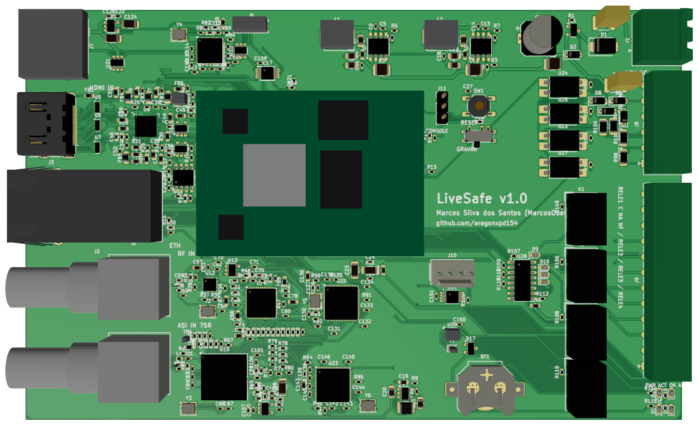

# 03 — PCB

> Projeto e PCB de **Marcos Silva dos Santos** (MarcosObel). Placa gerada por `tools/gerador-kicad/pcbgen.py` a
> partir de `designs.py` (ligações) e `layouts.py` (planta).

## Dados gerais

| Item | Valor |
|---|---|
| Tamanho | 160 × 100 mm, cantos com raio de 2 mm (caixa Hammond 1455N1601) |
| Camadas | 4 — L1 sinal · L2 GND · L3 3,3 V / 5 V · L4 sinal + GND |
| Empilhamento | JLCPCB **JLC04161H-7628**, 1,6 mm, impedância controlada |
| Trilha / folga mínimas | 0,1 / 0,1 mm (escape do BGA de 0,65 mm); 0,15 / 0,12 mm no geral |
| Via | 0,45 / 0,2 mm (0,4 / 0,2 mm no BGA do TC358743) |
| Componentes | 362, todos na face de cima |

## Planta

| Região | O que fica |
|---|---|
| Borda traseira (x = 0) | USB-A, HDMI, RJ45, BNC RF, BNC ASI |
| Borda frontal (x = 160) | 12 V, entradas (6 vias), relés (12 vias), LEDs PWR/ACT/OK/ALM |
| Faixa de cima | hub USB e chave de serviço (esquerda); buck de 5 V, buck de 3,3 V e proteção de entrada (direita) |
| Entre o HDMI e o CM4 | TC358743 com LDOs, oscilador, PCA9517 e ESD |
| Centro | CM4 (conector 101–200 em cima: CSI e USB; 1–100 embaixo: Ethernet, GPIO, 5 V) — nada embaixo do módulo |
| Embaixo, à esquerda | RF (Si2141 → Si2183) e ASI (GS2961A) junto dos BNC, com as duas FX2LP ao lado |
| Direita | entradas optoacopladas, relés, ULN2003A, RTC com CR1220, ventoinha, RESET, GRAVAR, console |

## Planos e alimentação

- **L2 (In1.Cu) — GND inteiro**, sem trilha. Cada pino de terra SMD desce por uma via própria, colocada pelo
  gerador ao lado do pino (ou dentro dos pads expostos).
- **L3 (In2.Cu) — 3,3 V** em quase toda a placa e **5 V** na faixa do buck de 5 V até os pinos de 5 V do CM4. O
  3,3 V contorna o CM4 por baixo, ligando os dois lados.
- **L1 e L4** recebem preenchimento de GND no fim, costurado pelas vias de descida.
- Os trilhos menores (1,2 V, 2,5 V, 1,8 V, filtrados por ferrite) seguem por trilha larga (classe *Alimentação*).
- No centro do **TC358743**, 5 das 9 bolas de GND ligam na bola vizinha pelo L1 em vez de ganhar via própria
  (`BGA_TIES` no `layouts.py`). Ficam 4 vias de GND no centro, e o espaço liberado no L4 é usado pelas
  alimentações internas do chip (VDDMIPI, AVDD33, VDDC2).

## Decisões de planta para o roteamento

- **Faixa livre** em volta dos CIs de passo fino (Si2141 0,9 mm, Si2183 0,75 mm, TC358743 0,6 mm, GS2961A e
  FX2LP 0,5 mm): os passivos ficam perto, mas deixam corredor para a saída das trilhas (`HALO`).
- **Barramento de TS do demodulador**: os 12 resistores de série formam uma fileira logo abaixo do Si2183, na
  ordem dos pinos (perto da fonte, como pede a terminação série). Há dois corredores sem componentes: entre o
  Si2183 e a fileira, e embaixo da FX2LP #1. O cristal da FX2LP #1 fica do lado esquerdo do chip.

## Classes de rede

| Classe | Largura / folga | Redes |
|---|---|---|
| Potência | 0,5 / 0,15 mm | 12 V, 5 V fora do plano, chaveamento dos buck, VBUS da USB-A |
| Alimentação | 0,25 / 0,12 mm | trilhos locais (1,2 V, 2,5 V, 1,8 V, TC_*, DEM_*, ASI_*), relés |
| Dif100 | 0,18 / 0,12 mm | HDMI, CSI-2, Ethernet (100 Ω diferencial) |
| Dif90_USB | 0,2 / 0,12 mm | USB do CM4, do hub, das FX2LP, da USB-A e de serviço (90 Ω) |
| RF75 | 0,16 / 0,15 mm | antena e entrada ASI (75 Ω) |
| Default | 0,15 / 0,12 mm | demais sinais |

As larguras dos pares foram reduzidas para caber na saída dos BGA de 0,65 mm. Antes de fabricar, conferir no
[calculador de impedância da JLCPCB](https://jlcpcb.com/pcb-impedance-calculator) para a pilha JLC04161H-7628
e, se preciso, alargar os pares fora da região dos BGA (ver [docs/08](08-revisao-e-riscos.md)).

## Roteamento e DRC

1. Vias de descida para os planos (gerador próprio, com checagem de folga contra pads, trilhas e vias).
2. Escape das bolas internas dos BGA (TC358743 e GS2961A) por via em *dog-bone*.
3. **Freerouting 1.9** para as demais ligações em L1 e L4.
4. `completar.py`: roteador em labirinto (A*, grade de 0,05 mm) que fecha as ligações que o Freerouting deixou;
   quando não há caminho, remove os trechos de sinal que bloqueiam e roteia de novo (*rip-up and reroute*).
   Modos: `--fino` (trilha 0,1 mm, via 0,4 mm), `--ilhas` (de qualquer ponto de uma ilha da rede a qualquer
   ponto da outra), `--interna` (pequenos saltos no L3, fora da faixa do plano de 5 V) e `--rasgar`.
   Pares diferenciais e RF nunca são rasgados.
5. `limpar.py`: remove vias repetidas no mesmo ponto (fanout + Freerouting).
6. Preenchimento dos planos e DRC do KiCad — resultado em
   [`hardware/fabricacao/livesafe-placa/relatorio-drc.txt`](../hardware/fabricacao/livesafe-placa/relatorio-drc.txt).

### A placa desta revisão

- Freerouting com 30 passadas deixou 13 ligações; o `completar.py` fechou 12.
- A última (AGC1 do Si2141) era um cruzamento inevitável entre as saídas dos pinos de 0,4 mm: o SCL do
  sintonizador desce por uma via logo na saída do pino 3 e o *strap* de endereço (`TUN_ADDR`) foi refeito.
- Restam só avisos (não erros) no DRC: serigrafia sobre cobre e sobreposta (a JLCPCB recorta), 6 vias e 1
  trilha soltas de *dog-bone* (sem efeito elétrico) e o aviso de bibliotecas padrão fora da tabela do projeto.
- O Freerouting não é determinístico: regerar a placa produz outro roteamento, que pode precisar dos mesmos
  passos de acabamento. A placa versionada em `hardware/kicad/` é a referência.

O resumo do último DRC fica no fim deste arquivo, gerado junto com a placa.

## Resumo do último DRC

Gerado em 23/11/2026 pelo `fabricacao.py` (KiCad 7.0.11).

| Item | Valor |
|---|---|
| Componentes | 358 |
| Redes | 284 |
| Trechos de trilha | 3552 |
| Comprimento total de trilha | 8.49 m |
| Vias | 1038 |
| Erros de DRC | 0 |
| Ligações sem conexão | 0 |

Resultado: **DRC limpo** — nenhuma violação e nenhuma ligação pendente.
